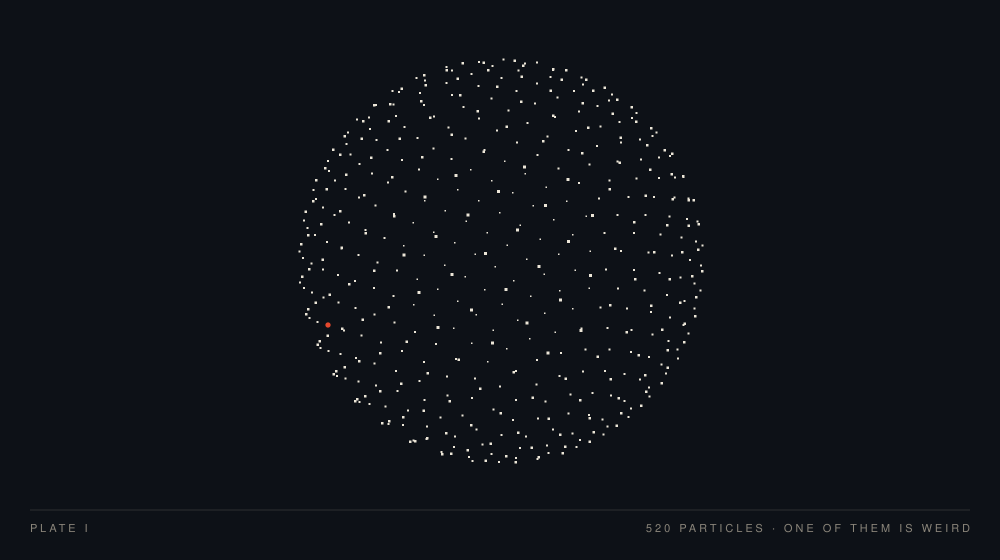
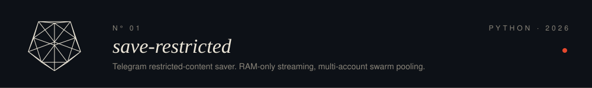
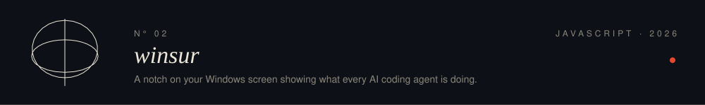
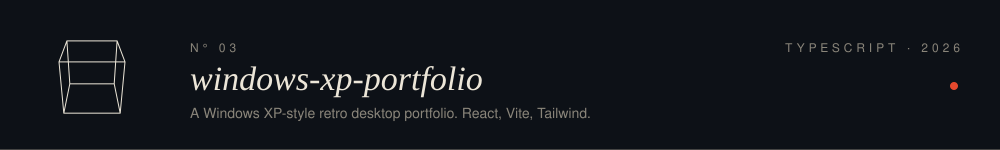
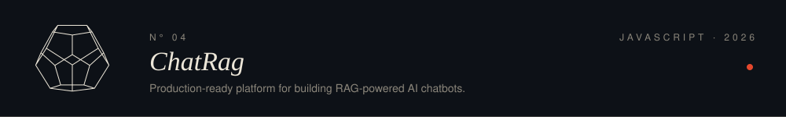
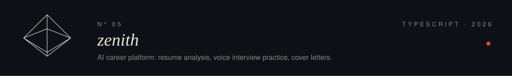
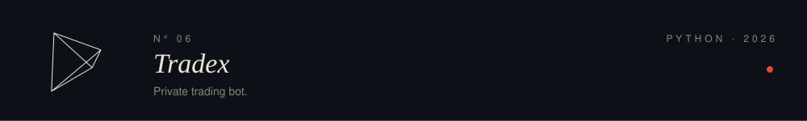
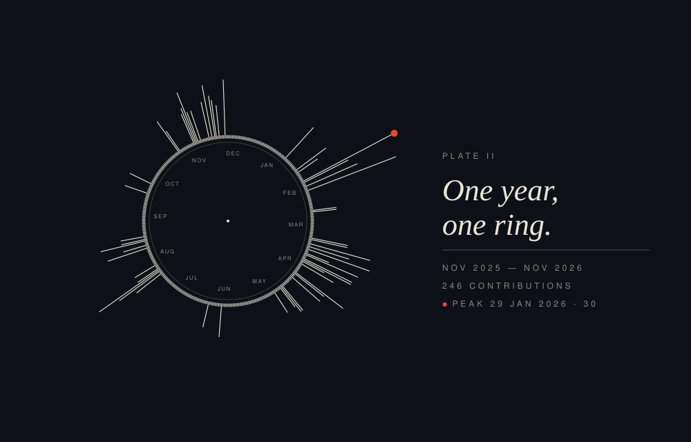

  

<b>SURIYA</b> &nbsp;·&nbsp; on GitHub since 2021 
<i>Untitled (Making the Web Weird Again)</i>, 2026 
520 particles &nbsp;·&nbsp; pure SVG &nbsp;·&nbsp; zero JavaScript

   

S E L E C T E D &nbsp; W O R K S

  

  

 

Every plate on this page is a hand-computed SVG. Nothing here runs JavaScript.

