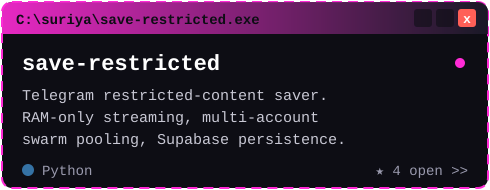
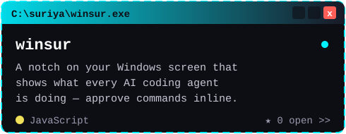
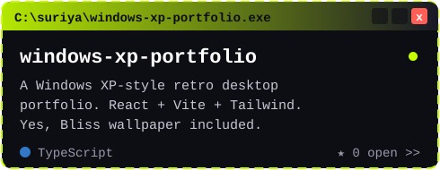
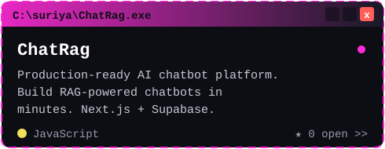
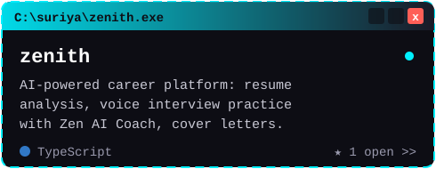
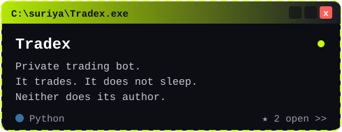
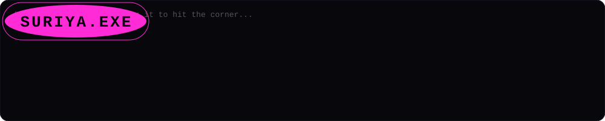
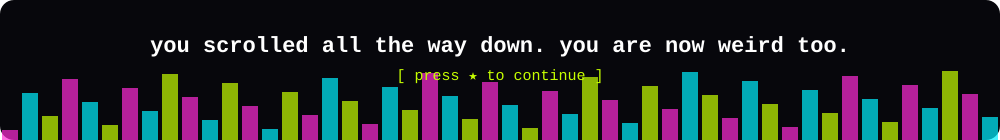

  

## `> ls ~/open-windows`

<table>
<tr>
<td></td>
<td></td>
</tr>
<tr>
<td></td>
<td></td>
</tr>
<tr>
<td></td>
<td></td>
</tr>
</table>

## `> cat ~/.toolbox`

## `> ./feed-the-snake.sh`

<picture>
  <source media="(prefers-color-scheme: dark)" srcset="https://raw.githubusercontent.com/suriya-z/suriya-z/output/snake-dark.svg" />
  <source media="(prefers-color-scheme: light)" srcset="https://raw.githubusercontent.com/suriya-z/suriya-z/output/snake-light.svg" />
  
</picture>

<b>🚫 do NOT click this</b>

 

you clicked it. now you have to wait until it hits the corner.

 

